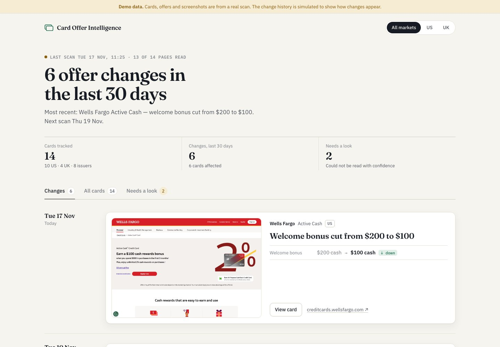
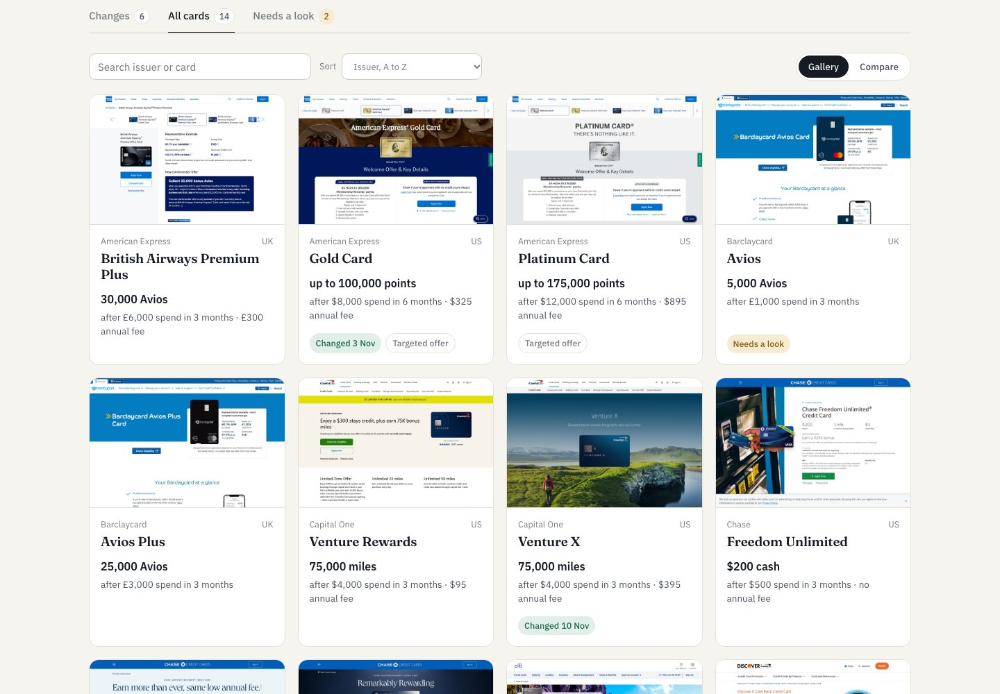
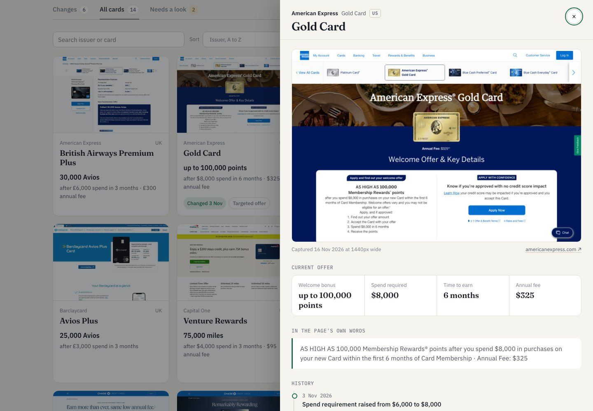

# Card Offer Intelligence

Twice a week, this opens 14 competitor credit card pages in a real browser, reads each
welcome offer, and compares it with the last scan. When anything moves, it records
what changed in plain language with a screenshot of the page as a customer saw it.
The dashboard shows what changed, when, and what every card's offer looks like today.

**[Live dashboard](https://itsvixu.github.io/card-offer-intelligence/) · [Demo with change history](https://itsvixu.github.io/card-offer-intelligence/demo/) · [Case study](https://itsvixu.github.io/card-offer-intelligence/case-study.html)**



## The problem

Card marketing and design teams track competitors by hand. Someone visits issuer pages,
screenshots them, and pastes numbers into a spreadsheet. Checks are irregular and
evidence gets lost.

The obvious automation, alerting when a page's copy changes, misses the changes that
matter most. When Chase moves a welcome bonus from 60,000 to 75,000 points, nothing on
the page says "new" or "updated". The number changes and every other word stays the
same.

So the system works on **meaning, not wording**. Each offer is read into four facts:
welcome bonus, spend required, time to earn, and annual fee. Those facts are compared
field by field. A page can be redesigned top to bottom without raising an alert, while
a $2,000 change to a spend requirement is always caught.

## Design decisions

**Lead with change, not inventory.** The first screen answers the one question people
open it with: what moved since I last looked? The full catalogue is one tab away. A
quiet week says so plainly rather than showing an empty table.

**Evidence over assertion.** Every change shows the before and after values next to a
screenshot of the live page, and every card quotes the page's own wording. A reader can
check any claim without leaving the dashboard.

**Plain language.** The pipeline compares field names like `bonusAmount`. People read
"Welcome bonus raised from 60,000 to 75,000 points". The email report and the dashboard
share one description module, so they always use the same words.

**Direction without judgement.** A competitor raising a bonus is information, not good
or bad news, so changes are marked ↑ or ↓ and never coloured red or green.

**Honest uncertainty.** If a page can't be read with confidence, the card goes to
*Needs a look* with the reason. It is never reported as changed or unchanged. A
targeted offer ("as high as 100,000 points") is labelled as a ceiling, not shown as a
guaranteed amount.

**Nothing to maintain per site.** The first version needed a CSS selector for every
page, and those break with every redesign. Rendered issuer pages share a more durable
pattern: in reading order, the first statement that pairs a bonus with a spend
requirement is the card's own offer. Later ones are cross-sells. Adding a card now
means adding a URL.





## Run it

Requires Node 22.5 or later.

```sh
npm install
npx playwright install chromium   # headless browser, about 100 MB, one-off

npm start          # scan all cards, then open the dashboard at http://localhost:4173
npm run demo       # dashboard with four weeks of simulated history (see below)
npm run site       # build the static site (live + demo + case study) into site/
npm test           # 103 tests, no network needed
```

Other commands:

```sh
npm run scan                     # scan only; writes data/ and output/run-report.md
npm run dashboard                # dashboard only, over the last scan
node run-scan.js --dry-run       # scan and classify, store nothing
```

**About the demo.** Real change history takes weeks of scans to build up. `npm run demo`
copies the real store and adds six simulated changes over four weeks, plus one failed
page and one that needs a look, so the change feed and timelines have content. Cards,
current offers, and screenshots are all real. The dashboard shows a permanent "Demo
data" banner in this mode.

## Unattended runs and the published site

Two workflows in [`.github/workflows/`](.github/workflows/):

- **`competitor-offer-scan.yml`** scans every Monday and Thursday at 08:00 UTC. It
  commits the store and any new screenshots back to the repo, so the history lives in
  git, then rebuilds and publishes the site to GitHub Pages.
- **`publish-site.yml`** runs the tests and republishes the site whenever `main`
  changes.

The published site is static. `scripts/build-site.js` writes the dashboard's data to
JSON next to the page, so no server is needed.

Optional secrets: `ANTHROPIC_API_KEY` lets an offer the parser can't read get a second
reading from Claude before it goes to *Needs a look*. Add `SMTP_SERVER`, `SMTP_PORT`,
`SMTP_USER`, `SMTP_PASS` and `REPORT_EMAIL_TO` to email the report. Without them, the
email step is skipped.

## Tracked cards

US: Chase Sapphire Preferred, Sapphire Reserve and Freedom Unlimited; American Express
Gold and Platinum; Capital One Venture and Venture X; Citi Strata Premier; Discover it
Cash Back; Wells Fargo Active Cash.

UK: Barclaycard Avios and Avios Plus; American Express British Airways Premium Plus;
HSBC Premier World Elite.

To add a card, add an entry to [`config/sources.json`](config/sources.json): an id,
issuer, product, market (`us` or `uk`) and URL. `offerSelector` is an optional override
for a page where the automatic reading picks the wrong statement.

## How it works

```
robots.txt check → render page (Playwright) → find the offer → parse 4 facts
   → compare with last scan → screenshot if changed → store → report + dashboard
```

| Module | Role |
|---|---|
| `src/browser.js` | Renders the page, declines optional cookies, returns text, HTML and a screenshot |
| `src/locate.js` | Finds the card's own offer in the page text, with no selector |
| `src/parse.js` | Reads bonus, spend, time and fee. An optional Claude fallback handles unreadable offers |
| `src/diff-engine.js` | Field-by-field comparison: NEW, CHANGED, DISCONTINUED, NO_CHANGE or NEEDS_REVIEW |
| `src/pipeline.js` | Runs the scan and keeps screenshots only when something changed |
| `src/store.js` | SQLite store of snapshots, runs, change events and captures |
| `src/describe.js` | Turns changes into plain language for the report and dashboard |
| `src/robots.js` | Never fetches a page that robots.txt disallows |
| `src/overview.js` | The dashboard's data, shared by the local server and the static build |
| `server.js`, `dashboard/` | Read-only server and the dashboard (no framework, no build step) |
| `scripts/build-site.js` | Static site for GitHub Pages: live dashboard, demo and case study |

## Limits

- **Public offers only.** Personalised offers behind a login or an eligibility check
  are out of reach. Pages that show a ceiling are labelled as targeted.
- **Some sites block automation.** Bank of America returned 403 and NerdWallet blocks
  bots, so neither is tracked. A blocked or redirected page goes to *Needs a look* and is
  never reported as a withdrawn offer.
- **Screenshots are taken at a 1440 px desktop width**, the top of the page only.
- **Storage grows with change**, not with time: one ~150 KB image per card when its
  offer moves.
